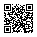

<!-- Generated by tools/docs.php from docs/src/choice.html - edit the source, not this file. -->

# Choice tiles

A group of radios or checks drawn as tiles - a package, a plan, a way to pay - the chosen one the only thing in color.

## Examples

`label class="choice"` wraps the input and its content; the input covers the tile unseen, so a click anywhere on it chooses, the arrow keys move between radios as always, and the focus ring goes round the tile. A group is a `fieldset` with its `legend`, the tiles laid out by a grid.

```html
<fieldset class="vstack gap-8">
	<legend class="form-label">Top up by</legend>
	<div class="grid cols-2 md:cols-3 gap-12">
		<label class="choice"><input type="radio" name="choice-amount" value="500"><span class="fs-20 fw-600 tabular-nums">500 THB</span><span class="fs-12 text-muted">About a month</span></label>
		<label class="choice"><input type="radio" name="choice-amount" value="1500" checked><span class="fs-20 fw-600 tabular-nums">1,500 THB</span><span class="fs-12 text-muted">A quarter, 5% off</span></label>
		<label class="choice"><input type="radio" name="choice-amount" value="6000"><span class="fs-20 fw-600 tabular-nums">6,000 THB</span><span class="fs-12 text-muted">A year, 15% off</span></label>
	</div>
</fieldset>
```

### With a logo

`choice-media` at the top of a tile is a white banner for a logo, white in both themes, so a logo on a transparent ground reads the same.

```html
<fieldset class="vstack gap-8">
	<legend class="form-label">Pay with</legend>
	<div class="grid cols-2 gap-12">
		<label class="choice"><input type="radio" name="choice-method" value="promptpay" checked><span class="choice-media"></span>PromptPay<span class="fs-12 text-muted">Any Thai bank app</span></label>
		<label class="choice"><input type="radio" name="choice-method" value="card"><span class="choice-media"><i class="bi bi-credit-card fs-24" aria-hidden="true"></i></span>Card<span class="fs-12 text-muted">Visa, Mastercard</span></label>
	</div>
</fieldset>
```

## Keyboard and accessibility

- The input is the control and the tile's words its label: a screen reader says "1,500 THB A quarter, 5% off, radio button, checked, 2 of 3".
- The keys are the input's own: `Tab` into the group, the arrows between radios, `Space` on a check.
- The chosen tile is told by its border and tint, and by an outline in forced colors.

## Tokens

From [`css/components/choice.css`](https://github.com/redz-tech/REDZ.UI/blob/main/css/components/choice.css), which declares no custom property of its own.

It reads the theme's `--redz-space-4`, `--redz-space-12`, `--redz-space-16`, `--redz-border-strong`, `--redz-radius-12`, `--redz-bg`, `--redz-text-muted`, `--redz-primary`, `--redz-primary-subtle`, `--redz-focus`, `--redz-space-8`, `--redz-border`.
