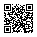

<!-- Generated by tools/docs.php from docs/src/commands.html - edit the source, not this file. -->

# Button commands

Buttons that act without a line of the page's script: copy a value, print the page, switch the theme, share an address. Each carries its command in `command` and names what it acts on in `aria-controls`, as [`--toggle`](collapse.md) does - no `commandfor`.

## Copy

`command="--copy"` copies its `data-copy`, or the value of the field `aria-controls` names, or that element's text. It says politely that it did - the page's texts `copy.done` and `copy.failed` - and shows a check in place of its icon for a moment; the page hears `redz:copy` with `detail.text`. A page served over plain http has no Clipboard API: the browser's copy command stands in.

```html
<label class="form-label" for="commands-copy-key">The key for the API</label>
<div class="input-group">
	<input class="form-control font-monospace" id="commands-copy-key" type="text" value="rz_live_4f9a1c2e7b" readonly>
	<button class="btn btn-icon" type="button" command="--copy" aria-controls="commands-copy-key" aria-label="Copy the key"><i class="bi bi-copy" aria-hidden="true"></i></button>
</div>
<div class="hstack gap-8">
	<button class="btn" type="button" command="--copy" data-copy="https://lagoon.example/tours/north-bay"><i class="bi bi-link-45deg" aria-hidden="true"></i>Copy the address</button>
</div>
```

## Download

`command="--download"` with `aria-controls` naming a field, a `textarea` or any element - a `pre` of a report - downloads its value or its text as a file: `data-file` names it, `download.txt` by default, and `data-type` is its type, `text/plain`. A `text/csv` file starts with a UTF-8 byte order mark, so a spreadsheet reads its letters right; `data-bom="false"` leaves it out. An element holding a picture - an `svg`, an `img`, a `canvas`, a [QR tile](qr.md#qr-download) - downloads it as a PNG instead. Each download is said politely, in the page's text `downloaded`. From code, `REDZ.ui.download({text, file, type, bom})` does the same for words made at the moment - a report built from the rows on the screen - and `{blob, file}` for a `Blob` of any kind.

```html
		<pre class="docs-code w-100" id="commands-download-text" tabindex="0">Boat A	12 trips	286 seats
Boat C	9 trips	201 seats</pre>
		<button class="btn" type="button" command="--download" aria-controls="commands-download-text" data-file="boats.txt"><i class="bi bi-download" aria-hidden="true"></i>Download the report</button>
```

```js
const rows = [...document.querySelectorAll('#agents tbody tr')].map((row) => [...row.cells].map((cell) => cell.textContent.trim()).join(';'));
REDZ.ui.download({text: rows.join('\r\n'), file: 'agents-2026-11-08.csv', type: 'text/csv'});
```

## Print

`command="--print"` prints the page. However printing starts - the button, the browser's menu, a key - every closed `details`, an accordion's item among them, and every region a `--toggle` button holds closed open for the paper and close again after. A card is not cut across two pages, and a scrolling card's body prints whole; the shell, toasts, the save bar and anything with `print:d-none` stay off the paper.

```html
<button class="btn" type="button" command="--print"><i class="bi bi-printer" aria-hidden="true"></i>Print</button>
```

## Theme

Buttons with `command="--theme"` and the value `light`, `dark` or `system` set the page's theme - `data-theme` on `html`, removed for system - and `aria-pressed` says which shows. One button with the value `toggle` flips the theme shown between light and dark, the system's read from `prefers-color-scheme`: it is pressed while dark, so its words name the dark theme. The page hears `redz:theme` with `detail.theme` and keeps the choice - in a cookie, in the account - and writes `data-theme` on `html` on its server, so the page paints in its theme at once.

```html
<div class="btn-group" role="group" aria-label="Theme">
	<button class="btn" type="button" command="--theme" value="light"><i class="bi bi-sun" aria-hidden="true"></i>Light</button>
	<button class="btn" type="button" command="--theme" value="dark"><i class="bi bi-moon" aria-hidden="true"></i>Dark</button>
	<button class="btn" type="button" command="--theme" value="system"><i class="bi bi-circle-half" aria-hidden="true"></i>System</button>
</div>
<button class="btn btn-icon" type="button" command="--theme" value="toggle" aria-label="Dark theme"><i class="bi bi-moon-stars" aria-hidden="true"></i></button>
```

## Share

`command="--share"` shares `data-share-url` - the page's own address when it has none - and `data-share-title` through the device's share sheet where it has one, as a phone does. Elsewhere it opens its menu, `aria-controls`, whose links the library writes by their class: `share-telegram`, `share-facebook`, `share-messenger`, `share-linkedin`, `share-vk`, `share-line` and `share-whatsapp`; a `--copy` item without `data-copy` copies the address. Each class gives its icon the network's colour; Bootstrap Icons has no VK mark, so `share-vk` draws its letters. Messenger opens its app, on a phone.

```html
<button class="btn" type="button" command="--share" aria-controls="commands-share-menu" aria-haspopup="menu" data-share-url="https://lagoon.example/tours/north-bay" data-share-title="North Bay by speedboat"><i class="bi bi-share" aria-hidden="true"></i>Share</button>
<div id="commands-share-menu" class="menu menu-start" popover role="menu" aria-label="Share">
	<a class="menu-item share-telegram" role="menuitem"><i class="bi bi-telegram" aria-hidden="true"></i>Telegram</a>
	<a class="menu-item share-whatsapp" role="menuitem"><i class="bi bi-whatsapp" aria-hidden="true"></i>WhatsApp</a>
	<a class="menu-item share-line" role="menuitem"><i class="bi bi-line" aria-hidden="true"></i>LINE</a>
	<a class="menu-item share-facebook" role="menuitem"><i class="bi bi-facebook" aria-hidden="true"></i>Facebook</a>
	<a class="menu-item share-messenger" role="menuitem"><i class="bi bi-messenger" aria-hidden="true"></i>Messenger</a>
	<a class="menu-item share-linkedin" role="menuitem"><i class="bi bi-linkedin" aria-hidden="true"></i>LinkedIn</a>
	<a class="menu-item share-vk" role="menuitem">VK</a>
	<button class="menu-item" type="button" role="menuitem" command="--copy"><i class="bi bi-link-45deg" aria-hidden="true"></i>Copy the address</button>
</div>
```

Three more networks: `share-x` posts on X with the title as its words, `share-viber` opens Viber's app with them - its mark drawn as letters, as VK's, or the page's own `img` or `svg` in the link -, and `share-wechat`, which has no address to share by, is a plain button that opens the page's popover with a [QR code](qr.md) of the address to scan in WeChat. `data-share-url` and `data-share-title` on any element write the links and the copy inside it, a row on the page without a menu: neutral buttons, each with the network's coloured icon and its name, as a filled brand colour leaves most names unreadable.

```html
<div class="hstack flex-wrap gap-8" role="group" aria-label="Share your link" data-share-url="https://lagoon.example/join?ref=sample" data-share-title="Book North Bay trips with my link">
	<a class="btn btn-sm share-whatsapp"><i class="bi bi-whatsapp" aria-hidden="true"></i>WhatsApp</a>
	<a class="btn btn-sm share-telegram"><i class="bi bi-telegram" aria-hidden="true"></i>Telegram</a>
	<a class="btn btn-sm share-x"><i class="bi bi-twitter-x" aria-hidden="true"></i>X</a>
	<a class="btn btn-sm share-viber">Viber</a>
	<button class="btn btn-sm share-wechat" type="button" commandfor="commands-share-wechat" command="toggle-popover"><i class="bi bi-wechat" aria-hidden="true"></i>WeChat</button>
	<button class="btn btn-sm" type="button" command="--copy"><i class="bi bi-link-45deg" aria-hidden="true"></i>Copy the link</button>
	<div class="popover" id="commands-share-wechat" popover aria-label="Scan in WeChat">
		<div class="vstack gap-8 align-items-center">
			<div class="qr"></div>
			<p class="fs-12 text-muted">Scan in WeChat to share</p>
		</div>
	</div>
</div>
```

## Keyboard and accessibility

- Each command is a `button`: `Enter` and `Space` run it, and one that is `aria-disabled` does nothing.
- A copy is said once, politely, inside an open modal dialog when there is one; the check that shows for a moment is not read out.
- The theme buttons say which theme shows in `aria-pressed`; the one toggle is pressed while dark, its words the dark theme's.
- The share menu is a [menu](menu.md): it opens on its first link, the arrow keys move through it, and `Escape` closes it back to its button, which says in `aria-expanded` whether it is open.

## Texts

The library has no words of its own; it reads these from the page's island `#redz-ui-text`.

| Key | For | In English |
| --- | --- | --- |
| `copy.done` | Said when a copy is done | Copied |
| `copy.failed` | Said when the browser refuses it | Could not copy |
