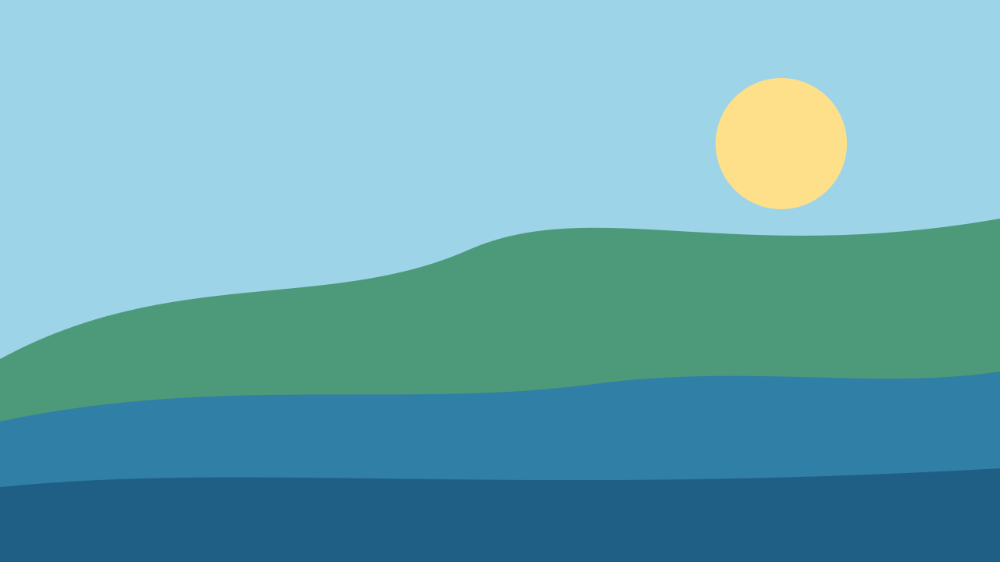

<!-- Generated by tools/docs.php from docs/src/crop.html - edit the source, not this file. -->

# Photo crop

A photo framed in the browser before it is sent: a paper - a voucher, a receipt, a form - straightened from four corners the library places on its edges, an avatar under a circle, or a photo in a frame of a ratio.

## A package of the release

The crop is linked apart, on the screens that take such a photo, beside the two files and after the library's script.

```html
<link rel="stylesheet" href="redz-ui/css/redz-ui-crop.min.css">
<script type="module" src="redz-ui/js/redz-ui-crop.min.js"></script>
```

## A paper

`data-crop` on an `input type="file" accept="image/*"` opens the photo a person picks full screen, dark, under a frame the library placed on the paper's edges, or around the whole photo when it found no paper. A corner or an edge is dragged, a loupe above the finger showing what the finger hides; or pressed, and then the spot it goes to is tapped; or moved by the arrow keys. An edge moves across itself, both its corners with it. Rotate turns the photo by 90 degrees, Whole photo and Auto frame switch the frame, Retake opens the picker again, Cancel and `Escape` leave the field empty. Done puts the straightened photo back into the field as a file, so the form sends it as it is; what is clear in the photo turns white. Without the script the field sends the photo as it was taken.

```html
<div class="form-field max-w-360">
	<label class="form-label" for="crop-sample-photo">Voucher photo</label>
	<input class="form-control" type="file" id="crop-sample-photo" name="voucher" accept="image/*" data-crop data-crop-max="1200" data-crop-quality="0.6" aria-describedby="crop-sample-hint">
	<div class="form-text" id="crop-sample-hint">On a phone, from the gallery or the camera.</div>
</div>
<div class="hstack flex-wrap gap-12">
	<button class="btn" type="button" data-docs-crop="crop-sample-photo"><i class="bi bi-image" aria-hidden="true"></i>Try a sample photo</button>
	<output class="text-muted" data-docs-cropped></output>
</div>
```

The sizes are the page's: its own settings go into `data-crop-max`, `data-crop-quality` and `data-crop-type`. The numbers below are only what a field that says nothing gets.

| Part | What it does |
| --- | --- |
| `data-crop` | On an `input type="file"`: its photo opens in the crop as it is picked, and the cropped file takes its place, named as the photo was with the result's extension. Empty or `paper` for a paper, `avatar` or `photo` for those. A photo the browser cannot open leaves the field empty and says so in a toast, the page's text `crop.unreadable`. Leave out `capture`, so a phone offers the gallery too. |
| `data-crop-max` | The result's long side at most, in pixels: `600` for a paper, `512` for an avatar, `1600` for a photo, unless it says. A photo is never enlarged past its own pixels. |
| `data-crop-quality` | The quality from 0 to 1 of a JPEG or a WebP: `0.6` for a paper, `0.85` for an avatar or a photo, unless it says. |
| `data-crop-type` | `image/jpeg` unless it says, or `image/png` or `image/webp`, which keep what is clear in an avatar or a photo; a browser that writes no WebP gives a PNG. |
| `data-crop-ratio` | A photo's frame, its width to its height: `4/3`, `16:9` or `1.5`; free without it. |
| `redz:crop` | Fired on the field once it holds the cropped file: `detail` is the answer of `REDZ.ui.crop` and `original`, the file as it was picked, for a server that cuts its own sizes from it by the `points`. |
| `crop` | The screen the library makes: a modal `dialog` with `data-mode`, its photo in `crop-stage`, the corners and the edges `crop-handle` buttons in `crop-handles`, a group with `role="application"`, a photo's frame `crop-move`, the buttons in `crop-bar`, an avatar's zoom in `crop-zoom`. |

## An avatar

`data-crop="avatar"` stands a circle in the middle and moves the photo under it: dragged by a finger, zoomed by two, by the wheel, by the slider or by `+` and `-`, moved by the arrow keys. It zooms out until the whole photo is in the circle - a firm's logo fits - and in to six times the circle covered. The result is the circle's square, the circle only drawn where the avatar stands; outside the photo it is white in a JPEG and clear in a PNG or a WebP.

```html
<div class="form-field max-w-360">
	<label class="form-label" for="crop-avatar-photo">Your photo</label>
	<input class="form-control" type="file" id="crop-avatar-photo" name="avatar" accept="image/*" data-crop="avatar">
</div>
<div class="hstack flex-wrap gap-12">
	<button class="btn" type="button" data-docs-crop="crop-avatar-photo" data-docs-sample="person"><i class="bi bi-person-circle" aria-hidden="true"></i>Try a sample photo</button>
	<span class="avatar" data-docs-avatar hidden></span>
	<output class="text-muted" data-docs-cropped></output>
</div>
```

## A photo

`data-crop="photo"` lays a frame over the photo, as large as the photo holds at `data-crop-ratio`, or the whole photo when the ratio is free. Its corners and its edges are dragged, a ratio kept about the middle of the other way; the frame itself is dragged, or moved by the arrow keys when it has the focus. Rotate keeps the ratio. A cover, a photo of a place, an icon of 1:1 in a PNG.

```html
<div class="form-field max-w-360">
	<label class="form-label" for="crop-photo-file">Cover</label>
	<input class="form-control" type="file" id="crop-photo-file" name="cover" accept="image/*" data-crop="photo" data-crop-ratio="16/9" data-crop-type="image/webp">
</div>
<div class="hstack flex-wrap gap-12">
	<button class="btn" type="button" data-docs-crop="crop-photo-file" data-docs-sample="view"><i class="bi bi-image" aria-hidden="true"></i>Try a sample photo</button>
	<output class="text-muted" data-docs-cropped></output>
</div>
```

## In an upload

An `upload`'s input with `data-crop` opens each file in the frame before the upload takes it - picked, dropped on its zone or pasted - by the input's `data-crop` attributes. Done takes the cropped file the usual way: its row, its preview, and `redz:files` with `original`, the file as picked, and `points`, the frame's corners, beside `file`; `redz:crop` fires on the input as well. Cancel changes nothing: a stored row stays, and the input holds what it held. A file the input's `accept` refuses is refused before the frame; the size and count limits judge the cropped file. A page without the crop package gets the file as it was picked. Here a logo - an SVG too - comes out a PNG of at most 1024 px.

```html
<div class="upload upload-image max-w-360">
	<input class="visually-hidden" id="crop-upload-input" type="file" name="logo" accept="image/png,image/jpeg,image/webp,image/svg+xml" data-crop="photo" data-crop-type="image/png" data-crop-max="1024" tabindex="-1" aria-label="Logo">
	<ul class="upload-list" aria-label="Logo">
		<li data-file-stored="3"><input type="hidden" name="logo_kept" value="3"><span data-file-name>logo.png</span><span class="invalid-feedback" data-file-error></span><button class="btn btn-xs btn-icon" type="button" data-file-remove aria-label="Remove logo.png"><i class="bi bi-x-lg" aria-hidden="true"></i></button></li>
	</ul>
	<button class="upload-zone btn btn-sm" type="button"><i class="bi bi-image" aria-hidden="true"></i>Choose another logo</button>
	<template>
		<li>
			
			<span data-file-name></span>
			<progress class="progress progress-xs"></progress>
			<span class="invalid-feedback" data-file-error></span>
			<button class="btn btn-xs btn-icon" type="button" data-file-remove><i class="bi bi-x-lg" aria-hidden="true"></i></button>
		</li>
	</template>
</div>
```

## From a script

`REDZ.ui.crop(file, options)` opens the same screen for a file the page holds and answers a promise: `{blob, width, height, points}`, or `null` when the person cancelled; it rejects for a file the browser cannot open as an image. A paper's result is the longer of each pair of the frame's opposite edges, read from a copy at most twice its size so small text stays clean. `points` are the frame's corners in the photo's own pixels, upright as the photo shows, the result's top left first, so a turn is in their order: given back as `options.points`, they open the frame where it was, turned as it was, to set it again or to read the original anew.

```js
const result = await REDZ.ui.crop(file, {max: settings.maxPx, quality: settings.quality / 100, retake: () => input.click()});
if (result !== null) {
	form.append('voucher', result.blob, 'voucher.jpg');
	form.append('frame', JSON.stringify(result.points));
}
```

| Option | What it does |
| --- | --- |
| `mode` | `paper` unless given, `avatar` or `photo`. |
| `ratio: 4/3` | A photo's frame, its width to its height, a number or a text such as `"16:9"`; free unless given. An avatar's is 1. |
| `max` | The result's long side at most: 600, 512 or 1600 by the mode unless given. |
| `type` | The result's type, `image/jpeg` unless given; a type the browser cannot write fails with the page's text `crop.failed`. |
| `quality` | The quality from 0 to 1, 0.6 or 0.85 by the mode unless given. |
| `points` | The frame to open with, as an answer gave it. |
| `retake` | A function the Retake button calls after it closes the screen; without it there is no Retake. |

The photo is read through an `img`, which stands it upright by its EXIF orientation, and worked on at most 4096 px on its long side, which every phone's canvas holds. An SVG - a logo - has no size of its own, or one of a few pixels: it is drawn by its `viewBox`, else by its `width` and `height` in pixels, at 4096 px on its long side, so the result is sharp whatever part the frame holds; read as an `img`, nothing in it runs and nothing outside it loads - live text takes the device's fonts, outlined text keeps its shapes. An SVG whose drawing the browser will not hand back, one with a `foreignObject`, is a file it cannot open. Give a logo `data-crop-type="image/png"`: a JPEG paints what is clear white, a PNG keeps it clear.

Each canvas is emptied as soon as it is done with, as Safari counts an unused one against its memory. The paper is looked for at 256 px: a bright, grey region near the middle of the photo, kept only when its four corners make a plain sheet.

## Accessibility

- The screen is a modal `dialog` named by its title; `Escape` cancels, and the focus goes back where it was.
- Each corner and edge is a 44 px button named by the page's words, "Top left corner", "Top edge"; the arrow keys move a focused one by a pixel of the screen, with `Shift` by 10. An edge's handle steps aside on a side shorter than two handles, unless it has the focus.
- A drag has a one-pointer way too: press a corner or an edge, then tap where it goes.
- An avatar's photo is a group that takes the focus: the arrow keys move the photo, `+` and `-` zoom it, and the zoom is a slider that says its per cent.
- Where a corner or the frame stands, in per cent of the photo, the zoom and whether a paper was found are read politely.
- No side of a frame gets shorter than a handle, so two corners never sit on one another.

## Texts

The library has no words of its own; the crop reads these from the page's island `#redz-ui-text`. A page gives the words of the modes it uses.

| Key | For | In English |
| --- | --- | --- |
| `crop.title`, `crop.avatar.title`, `crop.photo.title` | The screen's title by the mode | Frame the paper, Frame your photo, Frame the photo |
| `crop.hint`, `crop.avatar.hint`, `crop.photo.hint` | The line under it | Drag the corners to the edges of the paper… |
| `crop.frame`, `crop.avatar.frame`, `crop.photo.frame` | The frame's group; a photo's frame itself | Frame of the paper, Photo under the circle, Frame |
| `crop.keys`, `crop.avatar.keys`, `crop.photo.keys` | How the keys move it | Arrow keys move a corner or an edge… |
| `crop.cancel`, `crop.retake`, `crop.rotate`, `crop.done` | The buttons | Cancel, Retake, Rotate, Done |
| `crop.whole`, `crop.auto` | A paper's switch, to the whole photo and back to the paper found | Whole photo, Auto frame |
| `crop.top_left`, `crop.top_right`, `crop.bottom_right`, `crop.bottom_left` | The corners | Top left corner… |
| `crop.top`, `crop.right`, `crop.bottom`, `crop.left` | The edges | Top edge… |
| `crop.zoom`, `crop.zoom_in`, `crop.zoom_out`, `crop.zoomed` | An avatar's slider, its buttons, its value; `{n}` in per cent | Zoom, Zoom in, Zoom out, Zoom {n}% |
| `crop.at` | Where a corner, an edge or a frame stands; `{name}`, `{x}` and `{y}` in per cent | {name}: {x}% from the left, {y}% from the top |
| `crop.picked` | A corner or an edge pressed, waiting for its spot | {name} picked: tap where it goes |
| `crop.found`, `crop.none`, `crop.all`, `crop.again`, `crop.turned` | Said as the frame changes | The frame is on the edges of the paper… |
| `crop.failed`, `crop.unreadable` | A result that could not be written, a file that cannot be opened | The photo could not be saved… |
