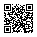

<!-- Generated by tools/docs.php from docs/src/qr.html - edit the source, not this file. -->

# QR codes

A white tile for a QR code: a scanner reads dark modules on white, so the tile stays white in the dark theme, in forced colors and on paper.

## Examples

`qr` around an inline `svg`, an `img` or a `canvas`. The code keeps its own quiet zone - four modules of white round it, drawn by the code's generator; the tile adds 8 px more. `--redz-qr-size` sets the code's width, 11rem (176 px) by default.

```html
<figure class="vstack gap-8 align-items-center">
	<div class="qr"></div>
	<figcaption class="fs-12 text-muted">Scan to open the docs</figcaption>
</figure>
<figure class="vstack gap-8 align-items-center">
	<div class="qr" id="qr-small"></div>
	<figcaption class="fs-12 text-muted">7.5rem</figcaption>
</figure>
```

## Accessibility

- A code is a picture of something a person may not be able to scan: give the same thing in words beside it - the address, or the secret key a 2FA app can take typed.
- An `img` gets an `alt` that says what the code holds; an inline `svg` gets `role="img"` and an `aria-label`.
- Forced colors leave the tile alone, so the code is never inverted.

## Tokens

From [`css/components/qr.css`](https://github.com/redz-tech/REDZ.UI/blob/main/css/components/qr.css), which declares no custom property of its own.

It reads the theme's `--redz-space-8`, `--redz-border`, `--redz-radius-8`, `--redz-qr-size`.
