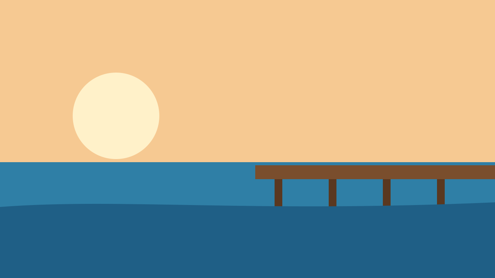
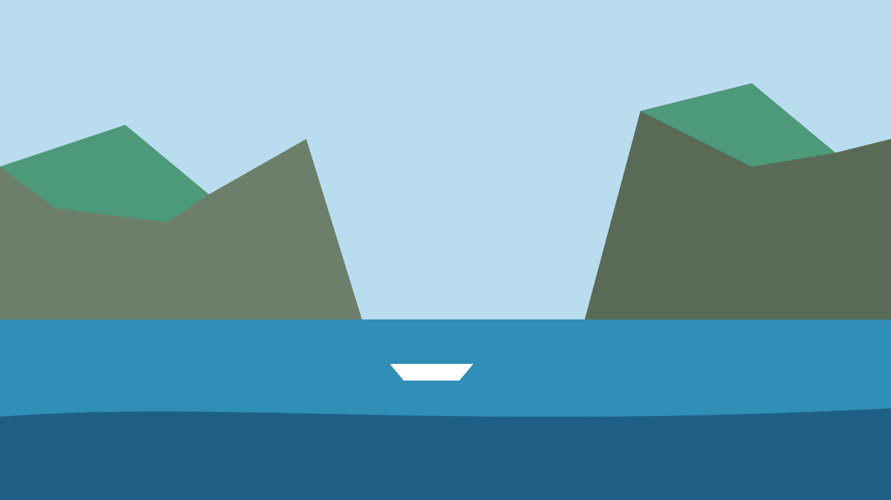

<!-- Generated by tools/docs.php from docs/src/viewer.html - edit the source, not this file. -->

# Image viewer

A picture opened large over the page: a link to the full image with `data-zoom`, and the library does the rest - one modal dialog it makes when first needed, which opens above an open dialog too.

## Examples

An `a` with `data-zoom` whose `href` is the full image, around its thumbnail. Links with the same word in `data-zoom` make a set, in the page's order: the arrow keys - mirrored right to left - and the viewer's buttons step through it, wrapping, and the count says where it is. The caption is the link's `title`, or its image's `alt`. `Escape`, × and a click beside the image close it, and the focus goes back to the link; a click with a modifier key opens the image as a link does.

```html
<div class="grid cols-3 gap-12">
	<a href="img/lagoon.svg" data-zoom="tour" title="The lagoon at North Bay"></a>
	<a href="img/pier.svg" data-zoom="tour" title="The pier at sunset"></a>
	<a href="img/cliffs.svg" data-zoom="tour"></a>
</div>
```

### Above a dialog

The viewer is in the top layer: opened from a dialog, it covers the dialog, and closing it leaves the dialog as it was, the focus back on the link. A link with an empty `data-zoom` opens its image alone.

```html
<button class="btn" type="button" commandfor="viewer-dialog-room" command="show-modal">The room</button>
<dialog class="dialog" id="viewer-dialog-room" aria-labelledby="viewer-dialog-room-title" closedby="any">
	<div class="dialog-header">
		<h2 class="dialog-title" id="viewer-dialog-room-title">Sea view, room 12</h2>
		<button class="btn btn-icon btn-text" type="button" commandfor="viewer-dialog-room" command="close" aria-label="Close"><i class="bi bi-x-lg" aria-hidden="true"></i></button>
	</div>
	<div class="dialog-body vstack gap-12">
		<a href="img/pier.svg" data-zoom title="The pier below the room"></a>
		<p>Two guests, a terrace, the pier a minute away.</p>
	</div>
</dialog>
```

## Keyboard and accessibility

- The viewer is a modal dialog named by its caption: the focus starts on ×, `Tab` stays inside it, and `Escape` closes it.
- In a set, `←` and `→` step - mirrored right to left -, and the caption with the count is said politely when it changes.
- The image keeps the thumbnail's `alt`; a link whose image has none is named by its `title`.

## Texts

The library has no words of its own; it reads these from the page's island `#redz-ui-text`.

| Key | For | In English |
| --- | --- | --- |
| `close` | The × button | Close |
| `viewer.prev`, `viewer.next` | The buttons that step through a set | Previous image, Next image |
| `viewer.count` | Where the image is in its set; `{position}` and `{count}` | {position} of {count} |

## Tokens

From [`css/components/viewer.css`](https://github.com/redz-tech/REDZ.UI/blob/main/css/components/viewer.css). It declares `--redz-btn-bg`, `--redz-btn-fg`, `--redz-btn-hover` on its root, never on rows or items.

It reads the theme's `--redz-space-64`, `--redz-space-16`, `--redz-space-24`, `--redz-space-12`, `--redz-fs-14`.
